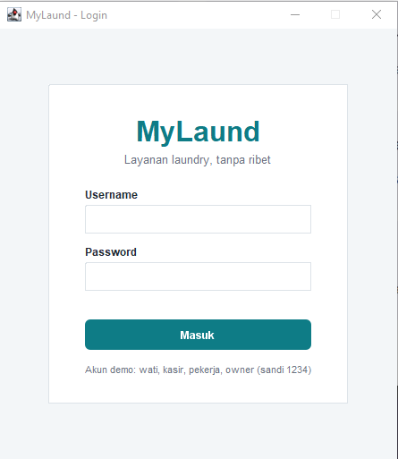
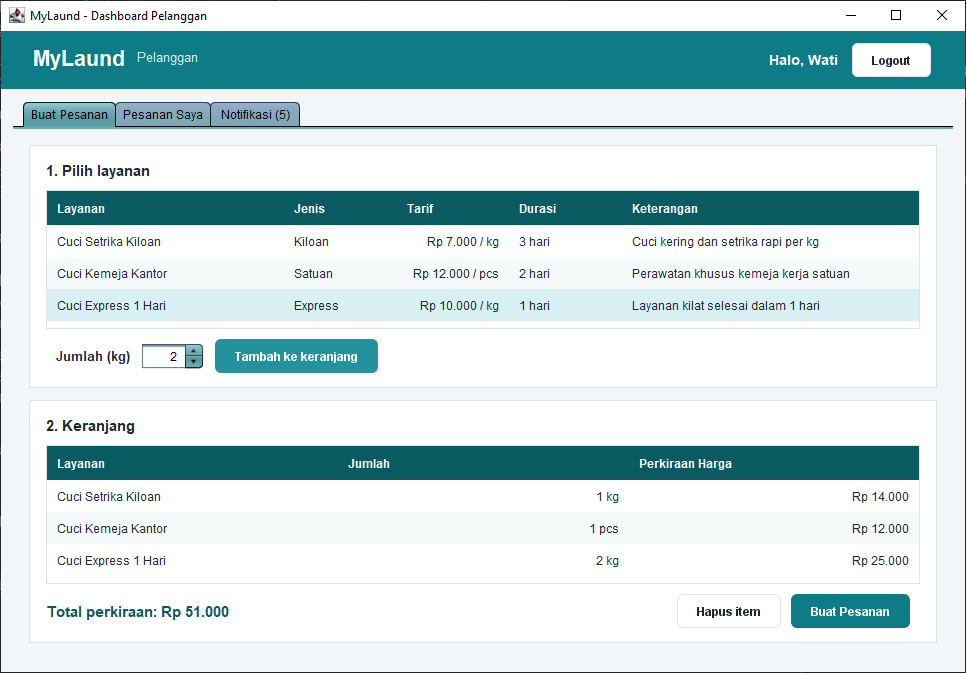
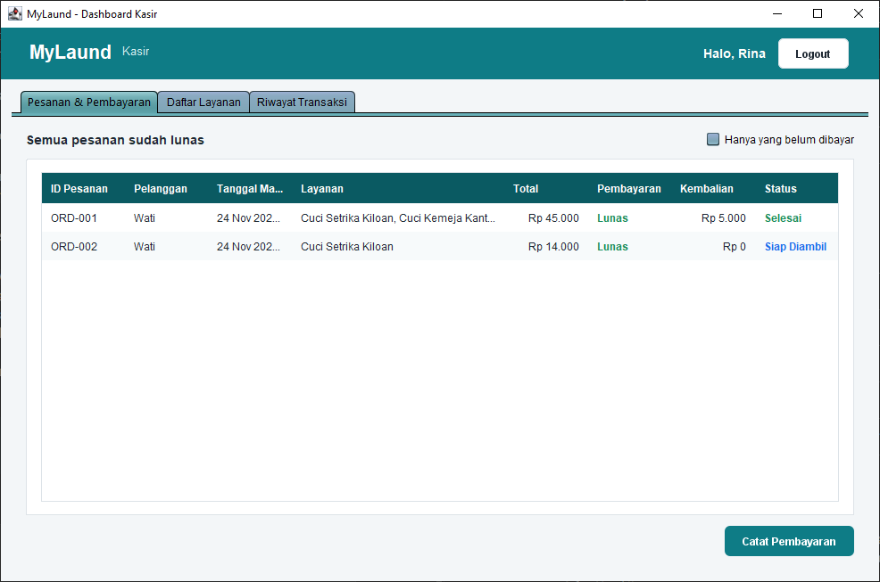
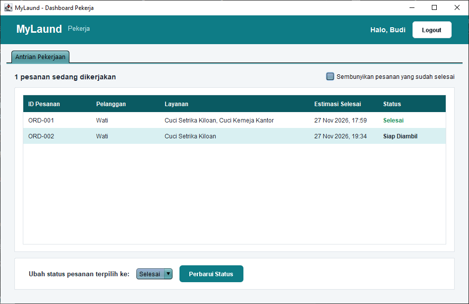
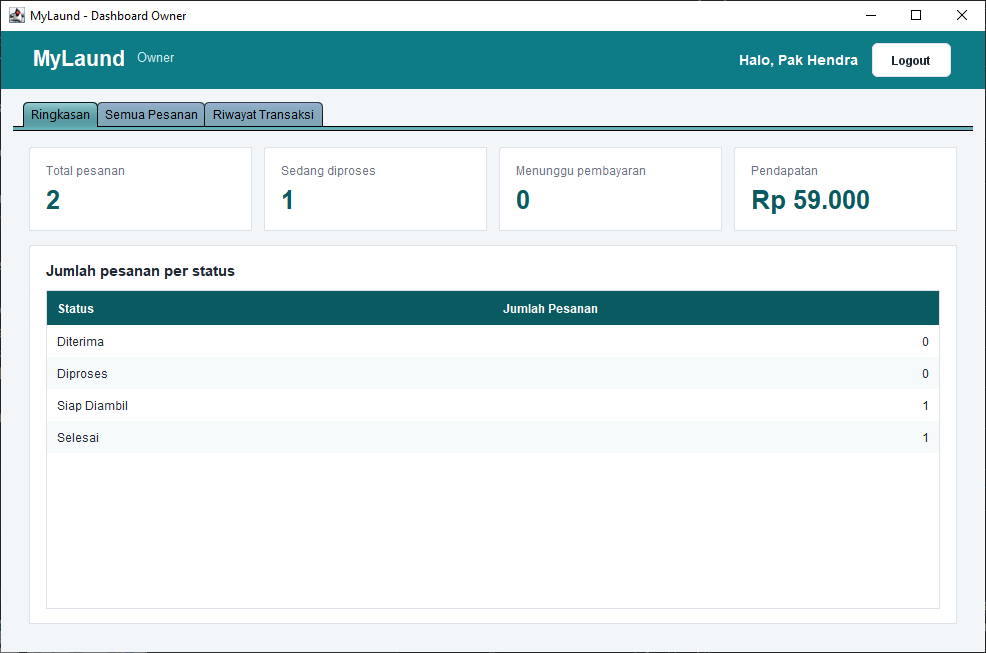

<div align="center">

# 🧺 MyLaund

**Aplikasi desktop manajemen laundry: pesanan, pembayaran, pelacakan status, dan notifikasi pelanggan dalam satu sistem.**


</div>

---

## Daftar Isi

- [Tentang Proyek](#tentang-proyek)
- [Fitur Utama](#fitur-utama)
- [Tangkapan Layar](#tangkapan-layar)
- [Teknologi](#teknologi)
- [Arsitektur](#arsitektur)
- [Penerapan Konsep OOP](#penerapan-konsep-oop)
- [Aturan Bisnis](#aturan-bisnis)
- [Memulai](#memulai)
- [Akun Demo](#akun-demo)
- [Struktur Proyek](#struktur-proyek)
- [Keterbatasan yang Diketahui](#keterbatasan-yang-diketahui)
- [Rencana Pengembangan](#rencana-pengembangan)
- [Tim Pengembang](#tim-pengembang)

---

## Tentang Proyek

Usaha laundry skala kecil sering mencatat pesanan dan pembayaran secara manual. Akibatnya status cucian sulit dilacak, pelanggan tidak tahu kapan cucian selesai, dan pemilik kesulitan melihat rekap usaha.

**MyLaund** menyelesaikan hal tersebut dengan satu aplikasi yang dipakai empat peran: pelanggan membuat pesanan, kasir mencatat pembayaran, pekerja memperbarui status pengerjaan, dan owner memantau ringkasan usaha. Data disimpan di SQLite lokal sehingga aplikasi dapat dijalankan tanpa menginstal server database.

Proyek ini dikembangkan sebagai Team Based Project mata kuliah Pemrograman Berorientasi Objek (PBO), Universitas Tidar.

## Fitur Utama

| Peran | Kemampuan |
|-------|-----------|
| **Pelanggan** | Melihat daftar layanan, membuat pesanan dengan keranjang, melihat estimasi harga, memantau riwayat dan status pesanan, menerima notifikasi |
| **Kasir** | Melihat dan memilih pesanan, mencatat pembayaran (TUNAI / QRIS) beserta kembalian, memfilter pesanan yang belum dibayar, melihat daftar layanan dan riwayat transaksi |
| **Pekerja** | Melihat antrian pekerjaan beserta estimasi selesai, menyembunyikan pesanan yang sudah selesai, dan memperbarui status pesanan |
| **Owner** | Melihat kartu ringkasan (total pesanan, sedang diproses, menunggu pembayaran, pendapatan), jumlah pesanan per status, daftar seluruh pesanan, dan riwayat transaksi |

Fitur lintas peran:

- **Tiga jenis layanan** dengan rumus harga berbeda: Kiloan, Satuan, dan Express.
- **Estimasi selesai otomatis** dihitung dari durasi layanan.
- **Notifikasi otomatis** ke pelanggan setiap status pesanan diperbarui.
- **Login berbasis peran**: setiap pengguna diarahkan ke dasbor sesuai perannya.
- **Persistensi data** SQLite: data tetap ada setelah aplikasi ditutup.

### Alur Status Pesanan

```text
DITERIMA  ──▶  DIPROSES  ──▶  SIAP_DIAMBIL  ──▶  SELESAI
```

## Tangkapan Layar

<table>
  <tr>
    <td align="center" width="50%"><b>Login</b><br></td>
    <td align="center" width="50%"><b>Dasbor Pelanggan</b><br></td>
  </tr>
  <tr>
    <td align="center"><b>Dasbor Kasir</b><br></td>
    <td align="center"><b>Dasbor Pekerja</b><br></td>
  </tr>
  <tr>
    <td align="center" colspan="2"><b>Dasbor Owner</b><br></td>
  </tr>
</table>

## Teknologi

| Komponen | Teknologi |
|----------|-----------|
| Bahasa | Java 26 |
| Antarmuka | Java Swing |
| Database | SQLite via `sqlite-jdbc` 3.46.1.3 |
| Build tool | Apache Maven |
| Pola desain | Layered Architecture, Repository Pattern, Constructor Injection |

## Arsitektur

MyLaund memakai arsitektur berlapis. Setiap lapisan hanya bergantung pada lapisan di bawahnya, dan lapisan service hanya mengenal **interface** repository, bukan implementasi SQLite-nya.

```text
┌──────────────────────────────────────────────────────────────────┐
│  UI (Java Swing)                                                 │
│  LoginFrame · PelangganView · KasirView · PekerjaView · OwnerView│
└────────────────────────────────┬─────────────────────────────────┘
                                 ▼
┌──────────────────────────────────────────────────────────────────┐
│  PesananController                                               │
└────────────────────────────────┬─────────────────────────────────┘
                                 ▼
┌──────────────────────────────────────────────────────────────────┐
│  Service                                                         │
│  AuthService · PesananService · PembayaranService ·              │
│  NotifikasiService                                               │
└────────────────────────────────┬─────────────────────────────────┘
                                 ▼
┌──────────────────────────────────────────────────────────────────┐
│  Repository (interface)                                          │
│  Pengguna · Layanan · Pesanan · Transaksi · Notifikasi           │
└────────────────────────────────┬─────────────────────────────────┘
                                 ▲ implements
┌────────────────────────────────┴─────────────────────────────────┐
│  Implementasi SQLite                                             │
│  Sqlite*Repository · DatabaseConnection                          │
└────────────────────────────────┬─────────────────────────────────┘
                                 ▼
                         ┌───────────────┐
                         │  mylaund.db   │
                         └───────────────┘
```

`App.java` bertindak sebagai *composition root*: di sinilah objek repository dibuat dan disuntikkan ke service lewat constructor, sehingga mengganti SQLite dengan penyimpanan lain tidak mengubah logika bisnis.

## Penerapan Konsep OOP

| Konsep | Penerapan di kode |
|--------|-------------------|
| **Abstraksi** | `LayananLaundry` sebagai kelas induk dengan perilaku `hitungHarga()` yang didefinisikan oleh turunannya |
| **Pewarisan** | `LayananKiloan`, `LayananSatuan`, dan `LayananExpress` mewarisi `LayananLaundry`; `Pelanggan`, `Kasir`, `Pekerja`, dan `Owner` mewarisi `Pengguna` |
| **Polimorfisme** | `hitungHarga()` menghasilkan perhitungan berbeda pada tiap jenis layanan; dasbor dipilih sesuai peran pengguna |
| **Interface** | `ITransaksi` diimplementasikan oleh `Pesanan` dan `Pembayaran`; `*Repository` memisahkan kontrak dari implementasi |
| **Enkapsulasi** | Atribut bersifat `private` dan diakses lewat getter/method domain |
| **Enum** | `StatusPesanan` membatasi status pesanan pada nilai yang valid |

## Aturan Bisnis

**Perhitungan harga**

| Jenis | Rumus |
|-------|-------|
| Kiloan | `tarif × max(berat, minimal berat)` |
| Satuan | `tarif × jumlah` |
| Express | `(tarif × jumlah) + biaya tambahan` |

**Estimasi selesai**: tanggal masuk ditambah durasi layanan. Pada pesanan dengan beberapa layanan, dipakai estimasi paling akhir.

**Layanan bawaan**

| Kode | Layanan | Jenis | Tarif | Durasi |
|------|---------|-------|-------|--------|
| L01 | Cuci Setrika Kiloan | Kiloan (min. 2 kg) | Rp7.000 / kg | 3 hari |
| L02 | Cuci Kemeja Kantor | Satuan | Rp12.000 / pcs | 2 hari |
| L03 | Cuci Express 1 Hari | Express | Rp10.000 + Rp5.000 biaya tambahan | 1 hari |

## Memulai

### Prasyarat

- **JDK 26** (nilai `maven.compiler.release` di `pom.xml`)
- **Apache Maven** 3.9+
- Lingkungan desktop dengan layar (aplikasi berbasis Swing)
- Koneksi internet saat pertama kali build, untuk mengunduh dependensi

```bash
java -version
mvn -v
```

### Menjalankan

```bash
# 1. Clone repositori
git clone <url-repositori>
cd MyLaund

# 2. Kompilasi dan jalankan
mvn compile exec:java
```

Jendela **Login MyLaund** akan tampil. File database `mylaund.db`, akun demo, dan layanan awal dibuat otomatis pada eksekusi pertama.

**Lewat IDE** (NetBeans / IntelliJ IDEA / Eclipse / VS Code): buka folder sebagai *Maven Project*, tunggu dependensi terunduh, lalu jalankan `src/main/java/mylaund/App.java`.

### Mengatur Ulang Data

Tutup aplikasi, hapus file `mylaund.db`, lalu jalankan kembali.

## Akun Demo

| Peran | Username | Password |
|-------|----------|----------|
| Pelanggan | `wati` | `1234` |
| Kasir | `kasir` | `1234` |
| Pekerja | `pekerja` | `1234` |
| Owner | `owner` | `1234` |

**Skenario uji cepat**

1. Login `wati` → *Buat Pesanan* → **Tambah ke keranjang** → **Buat Pesanan**.
2. Login `kasir` → *Pesanan & Pembayaran* → pilih pesanan → **Catat Pembayaran**.
3. Login `pekerja` → *Antrian Pekerjaan* → pilih pesanan → **Perbarui Status**.
4. Login `wati` kembali → cek status pesanan dan *Notifikasi*.
5. Login `owner` → lihat ringkasan dan riwayat transaksi.

## Struktur Proyek

```
MyLaund/
├── pom.xml
└── src/main/java/mylaund/
    ├── App.java              # Composition root & titik masuk aplikasi
    ├── model/                # Entitas domain (Pengguna, Pesanan, Layanan*, Pembayaran, ...)
    ├── repository/           # Kontrak akses data (interface)
    │   └── sqlite/           # Implementasi SQLite & pengelolaan koneksi/skema
    ├── service/              # Logika bisnis (Auth, Pesanan, Pembayaran, Notifikasi)
    └── ui/                   # Tampilan Swing & PesananController
```

## Keterbatasan yang Diketahui

Dicatat secara terbuka agar jelas batasan versi saat ini:

- **Autentikasi masih untuk keperluan demo.** Kata sandi disimpan dengan pola `HASH_<sandi>`, bukan algoritma hash sungguhan (mis. bcrypt/Argon2). Jangan dipakai untuk data nyata sebelum diganti.
- **Pembayaran hanya dicatat**, belum terhubung ke payment gateway; metode QRIS sebatas label metode.
- **Notifikasi** disimpan dan ditampilkan di aplikasi serta dicetak ke konsol; belum dikirim lewat SMS/WhatsApp/email.
- **Belum ada pengujian otomatis** (unit/integration test).
- Aplikasi berjalan **lokal tanpa multi-user terpusat**: database SQLite berada di komputer yang menjalankan aplikasi.

## Tim Pengembang

**Tim espisangijo**, mata kuliah Pemrograman Berorientasi Objek, Universitas Tidar. Dosen pengampu: Imam Adi Nata, M.Kom.

| Nama | Peran |
|------|-------|
| Aufa | Ketua tim |
| Naveed | Pengembang |
| Tarin | Perancang kelas |
| Izza | Analis kebutuhan |
| Iva | Penguji & dokumentasi |

---

<div align="center">
Dibuat dengan ☕ dan Java oleh Tim espisangijo
</div>
